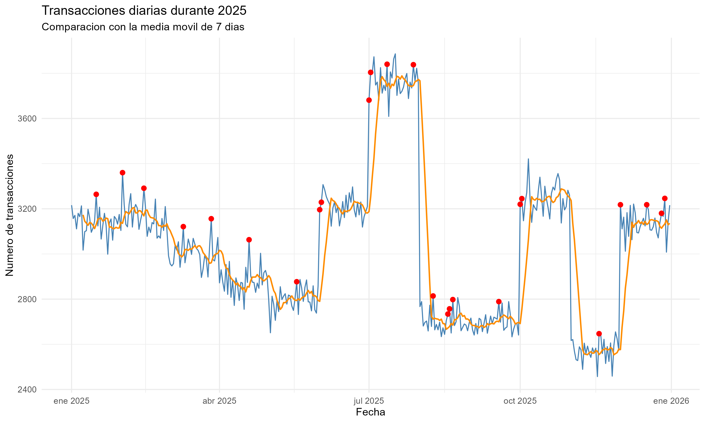

```{r}
#| label: configuracion
#| include: false

library(tidyverse)

# Cargar las funciones
source("cod/funciones_tarea3.R")

# Leer los parametros
parametros <- read_delim(
  "config/parametros_tarea3.csv",
  delim = ";",
  col_types = cols(.default = col_character())
)

# Leer la base de transacciones
transacciones <- read_delim(
  "data/transacciones_2025.csv",
  delim = ";",
  show_col_types = FALSE
)
# Obtener los parametros del ejercicio 1
ventana <- as.integer(
  parametros$valor[parametros$parametro == "ventana"]
)

k.alerta <- as.numeric(
  parametros$valor[parametros$parametro == "k.alerta"]
)
```

```{r}
#| label: resultados-ej1
#| include: false

# Aplicar la función con los parámetros personales
analisis.ej1 <- alerta.movil(transacciones, ventana, k.alerta)

# Resultado 1A: cantidad de días con alerta
resultado.1a <- sum(analisis.ej1$alerta, na.rm = TRUE)

# Resultado 1B: fecha de la primera alerta
resultado.1b <- analisis.ej1 |>
  filter(alerta == TRUE) |>
  slice_head(n = 1) |>
  pull(fecha)

# Resultado 1C: parámetros comunes
analisis.comun <- alerta.movil(transacciones, 7, 2)

resultado.1c <- sum(analisis.comun$alerta, na.rm = TRUE)
```

```{r}
#| label: hoja-respuestas
#| echo: false
#| comment: ""

cat(
  "RESULTADO_1A = ", resultado.1a, "\n",
  "RESULTADO_1B = ", format(resultado.1b, "%Y-%m-%d"), "\n",
  "RESULTADO_1C = ", resultado.1c, "\n",
  sep = ""
)
```


## Ejercicio 1 — Alertas por ventana móvil

Se analizaron las transacciones diarias de 2025 utilizando una ventana
de 7 días y un factor de 2 desviaciones estándar.

Se identificaron **25 días con alerta**, siendo el primero el
**16 de enero de 2025**.

### Gráfico de transacciones y alertas



